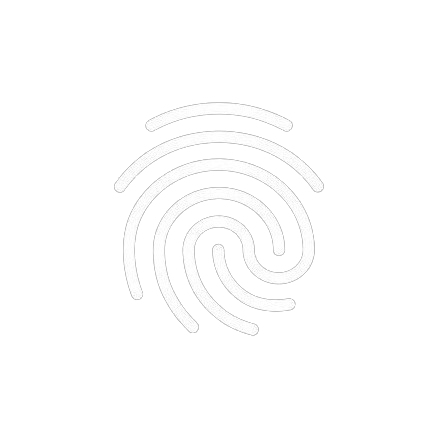
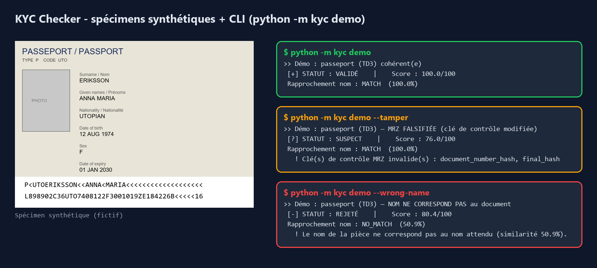
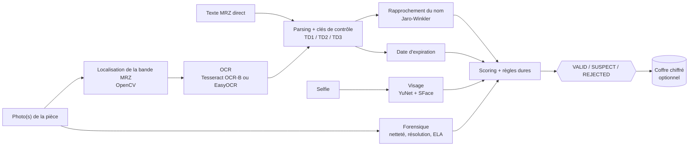
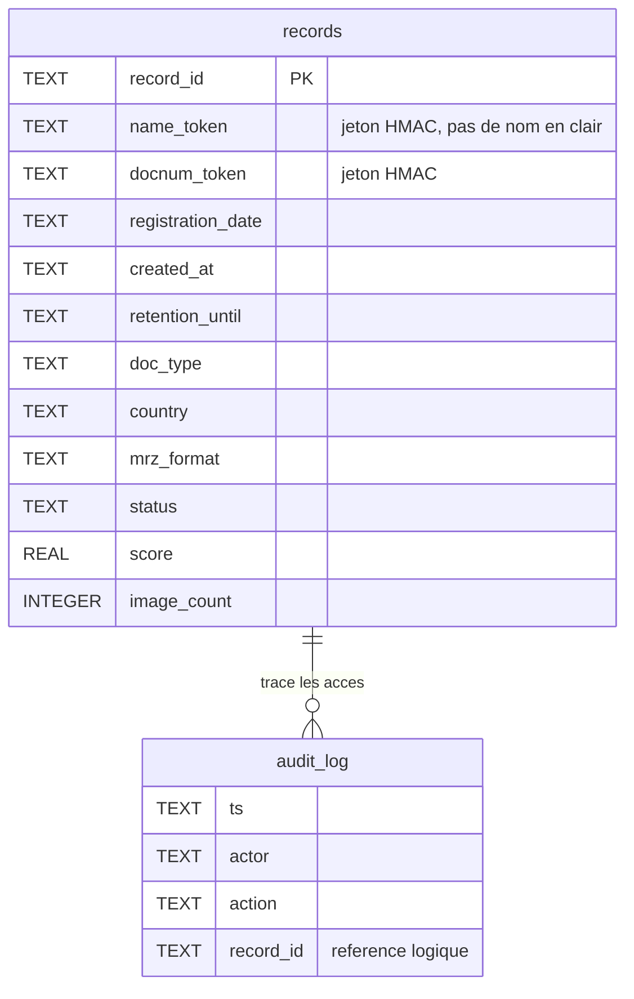

<div align="center">



# KYC Checker

**Moteur de vérification de pièces d'identité : MRZ, nom, visage, forensique, archivage chiffré.**


[](https://github.com/nagoloumdaniel/KYC-Checker/actions/workflows/ci.yml)




<sub>Visuel généré par [`tools/make_readme_visual.py`](tools/make_readme_visual.py) : spécimen entièrement fictif + sortie réelle du CLI. Ce n'est pas une capture d'interface (il n'y en a pas).</sub>

</div>

## Statut

**Prototype backend en cours de développement.** Le dépôt contient un moteur de vérification fonctionnel (CLI, bibliothèque Python, API HTTP) et un exemple d'intégration Next.js. Le [cahier des charges](cahier_des_charges_kyc.pdf) décrit une plateforme KYC bien plus large (parcours utilisateur complet, back-office...) : **elle n'est pas implémentée ici**. Ce dépôt est le moteur et le cadrage de la plateforme, pas un produit fini. Il n'existe aucune démo en ligne.

> Toutes les données utilisées (tests, démos, visuel) sont des **spécimens synthétiques**. Ne jamais committer de vraie pièce d'identité (voir [`.gitignore`](.gitignore) et [SECURITY.md](SECURITY.md)).

## Situation et problème

Un service qui inscrit des utilisateurs doit contrôler une pièce d'identité fournie en photo. La revue manuelle est lente, et un simple OCR ne dit pas si les données sont cohérentes : la zone MRZ (lignes de caractères en bas de la pièce) contient des clés de contrôle mathématiques, le nom saisi doit correspondre à celui du document, et le selfie doit ressembler à la photo.

## Solution

KYC Checker enchaîne ces contrôles et produit une **décision explicable** (`VALID`, `SUSPECT`, `REJECTED`) accompagnée des avertissements qui la justifient, pour qu'un humain relise les cas douteux.

- **MRZ ICAO Doc 9303** : TD1, TD2, TD3, détection automatique du format, correction des confusions OCR courantes, vérification des clés de contrôle (bibliothèque [`mrz`](https://pypi.org/project/mrz/)).
- **Rapprochement de nom** : similarité floue Jaro-Winkler (pur Python), classée `MATCH` / `PARTIAL` / `NO_MATCH`.
- **Comparaison de visage** : OpenCV YuNet (détection) + SFace (embedding), seuil cosinus configurable.
- **Contrôles image** : résolution, netteté, ELA expérimental. Ce sont des signaux d'aide à la revue, pas des preuves de fraude.
- **Archivage chiffré** : AES-256-GCM par enveloppe, index SQLite sans PII en clair (jetons HMAC), journal d'audit, rétention configurable.

## Fonctionnement



Le cœur (MRZ, nom, scoring) ne dépend que de `mrz` et fonctionne sans image. Les couches image/OCR, API et archivage sont optionnelles.

## Règles de décision

Le score vaut 60 points pour la proportion de clés de contrôle MRZ valides et 40 points pour la similarité de nom. Des **règles dures** plafonnent ensuite la décision : un score élevé ne peut pas blanchir un nom différent ou une clé invalide.

| Signal | Effet |
|---|---|
| MRZ illisible | **REJECTED** |
| Nom `NO_MATCH` (similarité sous 65) | **REJECTED** |
| Selfie différent de la photo de la pièce | **REJECTED** |
| Clé de contrôle MRZ invalide | plafond **SUSPECT** |
| Nom `PARTIAL` (65 à 85) | plafond **SUSPECT** |
| Document expiré | plafond **SUSPECT** |
| Indice de retouche (forensique) | plafond **SUSPECT** |
| Tout cohérent, nom `MATCH`, visage OK, non expiré | **VALID** |

Seuils et pondérations dans [`kyc/config.py`](kyc/config.py) (acceptation à 85, rejet sous 50, seuil cosinus visage 0,363).

## Exemple de sortie CLI

```text
$ python -m kyc demo --wrong-name
>> Démo : passeport (TD3) — NOM NE CORRESPOND PAS au document

============================================================
 [-] STATUT : REJETÉ    |    Score : 80.4/100
============================================================
 Rapprochement nom : NO_MATCH  (50.9%)
   attendu (norm.) : JEAN DUPONT
   pièce   (norm.) : ERIKSSON ANNA MARIA
 Avertissements :
   ! Le nom de la pièce ne correspond pas au nom attendu (similarité 50.9%).
```

Sortie abrégée. Elle illustre une règle dure : 80,4 points, mais `REJECTED` car le nom ne correspond pas.

## Installation

```powershell
py -V:3.13 -m venv .venv
.\.venv\Scripts\python.exe -m pip install -r requirements.txt          # cœur
.\.venv\Scripts\python.exe -m pip install -r requirements-image.txt    # image/OCR
.\.venv\Scripts\python.exe -m pip install -r requirements-api.txt      # API
.\.venv\Scripts\python.exe -m pip install -r requirements-storage.txt  # archivage

# Binaire Tesseract (Windows) :
winget install --id UB-Mannheim.TesseractOCR -e --silent
# Modèle OCR-B pour la MRZ (le modèle 'eng' par défaut lit mal le caractère '<') :
.\.venv\Scripts\python.exe tools\download_models.py
```

Seul `requirements.txt` est nécessaire pour la démo CLI et `verify --mrz`.

### CLI

```powershell
$env:PYTHONUTF8="1"
python -m kyc demo                      # passeport cohérent      -> VALIDÉ
python -m kyc demo --format td1         # carte d'identité (TD1)  -> VALIDÉ
python -m kyc demo --tamper             # clé MRZ falsifiée       -> SUSPECT
python -m kyc demo --wrong-name         # nom non concordant      -> REJETÉ

python -m kyc verify --name "Anna Eriksson" --mrz "<ligne1>\n<ligne2>"
python -m kyc verify --name "Anna Eriksson" --image passeport.jpg
python -m kyc verify --name "Anna Eriksson" --image recto.jpg --image verso.jpg
python -m kyc verify --name "Anna Eriksson" --image passeport.jpg --selfie selfie.jpg
```

### API HTTP

```powershell
.\.venv\Scripts\python.exe -m uvicorn kyc.api:app --host 0.0.0.0 --port 8000
```

Une fois lancée en local : Swagger UI sur `/docs`, ReDoc sur `/redoc`, schéma sur `/openapi.json`.

| Endpoint | Description |
|---|---|
| `GET /health` | État du service, version, disponibilité OCR, auth activée ou non |
| `POST /verify-mrz` | JSON `{mrz_text, name}` : rapport sans image |
| `POST /verify` | Multipart `name` + 1 à 2 images (recto/verso), `selfie` et `archive` optionnels : rapport |
| `GET /records` | Recherche de dossiers archivés (métadonnées uniquement) |

Les images sont traitées en mémoire, validées par signature (JPEG/PNG), limitées à 8 Mo et 2 images.

| Variable | Rôle |
|---|---|
| `KYC_API_KEYS` | Active l'authentification par clé d'API (liste séparée par des virgules, en-tête `X-API-Key` ou `Authorization: Bearer`) |
| `KYC_ARCHIVE_DIR` | Dossier du coffre d'archivage (défaut : `archive`) |
| `KYC_MASTER_KEY` | Clé maître base64 (32 octets) ; sinon un fichier `.master.key` est généré (dev) |
| `KYC_MODELS_DIR` | Dossier des modèles ONNX du visage |

### Docker

```powershell
docker compose up --build
```

L'image (Python 3.11) embarque Tesseract, OpenCV headless et le modèle OCR-B (environ 2 Go de RAM recommandés). Le Dockerfile n'a pas été reconstruit lors de cette mise à jour de documentation.

### Bibliothèque Python

```python
from kyc import verify_from_mrz, verify_images

report = verify_from_mrz(mrz_text, expected_name="Anna Maria Eriksson")
print(report.status, report.score, report.mrz_format)   # VALID 100.0 TD3

report = verify_images(["recto.jpg", "verso.jpg"], "Anna Eriksson")
```

### Intégration Next.js

Un client TypeScript, un proxy serveur (la clé d'API reste côté serveur) et un formulaire d'exemple sont dans [`integration/nextjs/`](integration/nextjs/README.md). Configuration par `KYC_API_URL` et `KYC_API_KEY`.

## Sécurité et vie privée

- **Chiffrement au repos** : AES-256-GCM, une clé de données (DEK) par dossier, chiffrée par la clé maître ; le tag GCM détecte toute altération.
- **Pas de PII en clair dans l'index** : nom et numéro de document sont remplacés par des jetons HMAC (recherche par égalité).
- **Traitement en mémoire** : les images envoyées à l'API ne sont écrites sur disque que si `archive=true`, et alors chiffrées.
- **Journal d'audit** : stockage, recherche, consultation (acteur, date).
- **Rétention** : `retention_days` (1825 jours par défaut) et purge via `Vault.purge_expired()` ou `tools/purge_expired.py` (à planifier).
- Docker : exécution sous utilisateur non-root.

Ce qui n'est pas couvert : voir [Limites](#limites). Signalement de vulnérabilité : [SECURITY.md](SECURITY.md).

## Stack

Versions vérifiées dans un environnement propre le 2026-10-29 (Python 3.14.7). Les `requirements*.txt` ne fixent que des bornes minimales.

| Composant | Rôle | Version testée |
|---|---|---|
| Python | Langage | 3.14.7 (développé sous 3.13, image Docker en 3.11) |
| `mrz` | Parsing et clés de contrôle MRZ | 0.6.2 |
| FastAPI / Uvicorn | API HTTP | 0.162.0 / 0.54.0 |
| OpenCV headless / NumPy / Pillow | Image, visage (YuNet + SFace), spécimens | 5.0.0.93 / 2.5.4 / 13.0.0 |
| pytesseract + Tesseract | OCR de la MRZ | 0.3.13 (binaire Tesseract non installé lors de la vérification) |
| `cryptography` | AES-256-GCM | 50.0.2 |
| SQLite | Index et audit | stdlib |
| pytest | Tests | 9.2.0 |
| TypeScript / Next.js | Exemple d'intégration | voir `integration/nextjs/` |

## Architecture

```text
kyc/
  names.py        Normalisation + matching flou de noms (Jaro-Winkler, pur Python)
  mrz_reader.py   MRZ TD1/TD2/TD3 : détection format, validation, correction OCR
  scoring.py      Score + décision + règles dures
  pipeline.py     Orchestrateurs : verify_from_mrz / verify_image(s) / verify_documents
  specimens.py    Spécimens synthétiques + rendu d'images de test
  config.py       Seuils réglables
  imaging.py      [opt] OpenCV : localisation de la bande MRZ
  ocr.py          [opt] Backends OCR (Tesseract + modèle OCR-B / EasyOCR)
  face.py         [opt] Détection/comparaison de visage (YuNet + SFace)
  forensics.py    [opt] Qualité image + heuristiques de falsification
  api.py          [opt] API FastAPI
  storage.py      [opt] Coffre chiffré + index SQLite + audit
  nfc.py          Note d'architecture (puce ePassport, non implémentée)
  cli.py          Ligne de commande
tools/            Spécimens, visuel du README, téléchargement des modèles, purge
integration/nextjs/  Client TypeScript + exemple Next.js
```

## Modèle de données

Le coffre utilise SQLite ; le contenu chiffré (rapport, images, clé de dossier) est stocké en fichiers dans le dossier d'archive. Les deux tables :



`audit_log.record_id` est une référence logique : aucune clé étrangère n'est déclarée dans le schéma.

## Tests

```powershell
.\.venv\Scripts\python.exe -m pip install -r requirements-dev.txt
.\.venv\Scripts\python.exe -m pytest -q
```

Recomptage du 2026-10-29 dans un venv neuf (Python 3.14.7, sans Tesseract ni modèles de visage) : **50 tests collectés, 42 passent, 8 sont ignorés, 0 échec**. Les 8 ignorés (OCR et modèles de visage indisponibles) couvrent le chemin image, la comparaison de visage et l'archivage via l'API : ils n'ont pas été exécutés dans cet environnement, leur état n'y est donc pas démontré. La CI GitHub exécute la même suite dans les mêmes conditions (sans Tesseract).

## Défis rencontrés

- **OCR du caractère `<`** : le modèle Tesseract `eng` par défaut le lit mal ; la MRZ exige le modèle **OCR-B**, téléchargé par `tools/download_models.py` et embarqué dans l'image Docker. Une correction des confusions OCR courantes complète le parsing.
- **Authenticité non vérifiable par image** : des clés MRZ correctes ne prouvent rien (un faux bien fabriqué passe). Seule la lecture de la puce NFC (ePassport) apporterait une preuve forte ; elle nécessite un client mobile et reste documentée, non implémentée.
- **Règles dures contre score** : un score pondéré seul peut laisser passer un nom différent (voir l'exemple CLI). D'où des plafonds de sévérité indépendants du score.
- **Recherche sans PII** : retrouver un dossier par nom sans stocker le nom en clair a conduit à des jetons HMAC.
- **Forensique** : l'ELA et la netteté produisent des faux positifs ; ils plafonnent à `SUSPECT` (revue humaine) et ne rejettent jamais seuls.

## Limites

- **Pas une preuve d'authenticité** : le moteur contrôle la cohérence interne et les correspondances, pas la validité physique du document.
- **Pas de détection de vivacité (liveness)** : une photo de photo ou un selfie rejoué n'est pas détecté.
- **NFC non implémenté** : `kyc/nfc.py` n'est qu'une note d'architecture.
- **Authentification désactivée si `KYC_API_KEYS` est absent** : ne pas exposer ainsi.
- **Pas de rate limiting** sur l'API.
- **Clé maître dans un fichier en développement** : pas de KMS.
- Entrée PDF non gérée.
- Aucune évaluation de conformité (RGPD, LCB-FT) : ce prototype n'est pas prêt pour traiter de vraies données personnelles en production.

## Feuille de route

- [x] Passeports (TD3), clés de contrôle, matching de nom, CLI.
- [x] Cartes d'identité (TD1/TD2), recto/verso.
- [x] API FastAPI et Docker.
- [x] Archivage chiffré, index, journal d'audit.
- [x] Comparaison de visage et heuristiques de falsification.
- [x] Authentification API par clé.
- [ ] Rate limiting.
- [ ] KMS pour la clé maître.
- [ ] Entrée PDF.
- [ ] Détection de vivacité.
- [ ] Client NFC (ePassport).
- [ ] Plateforme décrite dans le cahier des charges (hors périmètre actuel).

## Contribuer et contributeurs

Voir [CONTRIBUTING.md](CONTRIBUTING.md). Avant cette documentation, `main` compte 3 commits, tous de [Daniel Nagoloum Talla](https://github.com/nagoloumdaniel) (publiés sous deux identités Git : 2 et 1 commits). Un commit porte un trailer `Co-Authored-By: Claude` : une partie du code a été produite avec l'assistance d'un agent IA.

## Droits

**Aucune licence n'est accordée pour le moment : tous droits réservés par défaut.** Sans licence explicite, personne d'autre que l'auteur n'a le droit de copier, modifier ou redistribuer le code. Le choix d'une licence (par exemple MIT, Apache-2.0 ou une licence propriétaire) appartient à l'auteur et reste à trancher.

---

Développé par [Daniel Nagoloum Talla](https://github.com/nagoloumdaniel) · [portfolio](https://nagoloum.vercel.app)
